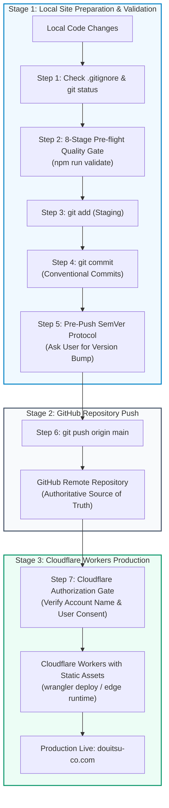

# Deployment Lifecycle, Quality Pipeline & Release Specifications (ထုတ်လွှင့်မှု လုပ်ငန်းစဉ်၊ စစ်ဆေးမှုနှင့် စနစ်သတ်မှတ်ချက်များ)

## 1. Master Deployment Lifecycle Workflow (`Local Site → GitHub Repo → Cloudflare Workers`)

DOUITSU LLC ၏ website ထုတ်လွှင့်မှု လုပ်ငန်းစဉ်သည် **Local Site (စမ်းသပ်တည်ဆောက်မှု)** မှ **GitHub Repository (ဗဟို Code သိမ်းဆည်းရာ)**၊ ထိုမှတစ်ဆင့် **Cloudflare Workers (အွန်လိုင်း ထုတ်လွှင့်မှု)** သို့ အဆင့် ၇ ဆင့်ဖြင့် စနစ်တကျ ချိတ်ဆက်ဆောင်ရွက်သည့် Continuous Pipeline ဖြစ်သည်။



---

## 2. Step-by-Step Deployment Pipeline

### အဆင့် (၁) — Check `.gitignore` & Inspect File Status
Code အသစ်များ မထည့်မီ `.gitignore` စည်းမျဉ်းများကို စစ်ဆေး၍ လျှို့ဝှက်ချက်များနှင့် မလိုအပ်သော ဖိုင်များ ကင်းစင်စေရမည်-
- **မဖြစ်မနေ လိုက်နာရန် စည်းမျဉ်းများ**:
  - လျှို့ဝှက် Environment files (`.env`, `.env.*`) ကို လုံးဝ track မလုပ်ရ။
  - Build output directory (`dist/`) နှင့် ယာယီ cache များ (`.astro/`, `node_modules/`) မပါဝင်စေရ။
  - Cloudflare R2 ပေါ်တွင် host ထားသော ပမာဏကြီးမားသည့် PDF များ (`public/files/*.pdf`) ကို repository ထဲသို့ commit မလုပ်ရ။
  - စစ်ဆေးရန် command:
    ```bash
    git status
    ```

---

### အဆင့် (၂) — 8-Stage Pre-Flight Quality Gate (`npm run validate`)

Production stability နှင့် code quality ကို ထိန်းသိမ်းရန်အတွက် commit/push မပြုလုပ်မီ အောက်ပါ **8-Stage Validation Pipeline** ကို ဖြတ်သန်းရမည်။ တစ်ဆင့်ချင်းစီသည် exit code `0` ဖြင့် ပြီးမြောက်ရမည် (Zero Errors Policy)။

```text
[1. ESLint] ──► [2. CSS Stylelint] ──► [3. Astro Check] ──► [4. SSG Build] ──► [5. HTML Validate] ──► [6. Schema.org] ──► [7. Images Check] ──► [8. Links Check] ──► [Safe to Commit]
```

#### အဆင့် ၈ ဆင့်၏ အသေးစိတ် သတ်မှတ်ချက်များ:
1. **Stage 1: ESLint (`npm run lint:eslint`)**:
   - Scope: `.astro`, `.ts`, `.js`, `.mjs` source files အားလုံး။
   - Parser: `eslint.config.mjs` (ESLint v9/v10 flat config) + `eslint-plugin-astro` + `@typescript-eslint/parser`။
2. **Stage 2: CSS Check (`npm run lint:css`)**:
   - Scope: `src/styles/fonts.css`, `src/styles/global.css` နှင့် stylesheets အားလုံး။
   - Config: `.stylelintrc.json` (Tailwind at-rules `@tailwind`, `@layer`, `@apply` များကို စနစ်တကျ စစ်ဆေးသည်)။
3. **Stage 3: Astro Diagnostic & Type Check (`npm run check:astro`)**:
   - Scope: TypeScript type analysis နှင့် Astro template validation။
   - Standard: `0 errors, 0 warnings, 0 hints` ဖြင့် အောင်မြင်ရမည်။
4. **Stage 4: Static Site Generation Build (`npm run build`)**:
   - Scope: Static site ကို `dist/` ထဲသို့ compile ပြုလုပ်ခြင်း။ Alpine.js bundles, dynamic routes နှင့် assets များ မှန်ကန်စွာ compile ဖြစ်ရမည်။
5. **Stage 5: HTML Validate (`npm run validate:html`)**:
   - Scope: `dist/` ထဲရှိ compiled HTML ဖိုင်များကို W3C/HTML5 web standards နှင့် accessibility (`aria-label`, semantic tags) စစ်ဆေးခြင်း။
6. **Stage 6: Schema.org Validation (`npm run validate:schema`)**:
   - Scope: `dist/` ထဲရှိ `<script type="application/ld+json">` Structured Data အားလုံးကို JSON syntax, Schema.org @context, Entity completeness (@type, @id, name, url, telephone, address, FAQPage, BreadcrumbList) ပြည့်စုံမှု စစ်ဆေးခြင်း။
7. **Stage 7: Broken Images Check (`npm run validate:images`)**:
   - Scope: `dist/` ထဲရှိ `` tags, favicons, apple-touch-icons, preloaded images, OpenGraph/Twitter banners နှင့် CSS background/mask images အားလုံး physical file အမှန်တကယ် ရှိ/မရှိနှင့် non-empty (size > 0) ဖြစ်မဖြစ် စစ်ဆေးခြင်း။
8. **Stage 8: Broken Links Check (`npm run validate:links`)**:
   - Scope: `dist/` ထဲရှိ in-page `#hash` anchors, cross-page navigation (`/#contact`, `/housing/`, `/license/`), `tel:`, `mailto:`, နှင့် external URLs အားလုံး broken link မရှိစေရန် စစ်ဆေးခြင်း။

#### အသုံးဝင်သော Validation Commands များ:
```bash
# Run full 8-stage validation pipeline
npm run validate

# Run runner script directly
./scripts/validate.sh

# Run quick code checks (ESLint + CSS + Astro Check)
npm run check

# Run individual checks
npm run lint:eslint      # ESLint code checks
npm run lint:css         # Stylelint CSS checks
npm run check:astro      # Astro & TypeScript check
npm run validate:html    # HTML5 validation on dist/
npm run validate:schema  # Schema.org JSON-LD structured data check
npm run validate:images  # Zero broken images / media assets check
npm run validate:links   # Zero broken links / anchor targets check
```

> [!NOTE]
> `.git/hooks/pre-commit` တွင် အလိုအလျောက် `npm run validate` run စေရန် hook တပ်ဆင်ထားပြီး ဖြစ်သည်။

---

### အဆင့် (၃) — Git Add (Staging)
`.gitignore` စစ်ဆေးပြီး လိုအပ်သော ပြင်ဆင်ချက် ဖိုင်များကိုသာ သီးသန့် stage လုပ်ပါ:
```bash
# သက်ဆိုင်ရာ ပြင်ဆင်ထားသော ဖိုင်များကိုသာ stage ပြုလုပ်ခြင်း
git add src/data/content.ts package.json

# သို့မဟုတ် စိစစ်ပြီး အားလုံးထည့်သွင်းခြင်း
git add .
```

---

### အဆင့် (၄) — Conventional Commit Message Rule (မဖြစ်မနေ လိုက်နာရန်)

Commit message ရေးသားရာတွင် နိုင်ငံတကာစံနှုန်းဖြစ်သော **Conventional Commits Specification** ကို တိကျစွာ လိုက်နာရမည်။

#### Commit Format:
```text
<type>(<optional scope>): <description>
```

#### Commit Types ဇယားနှင့် နမူနာများ:
| Type | အသုံးပြုရမည့် အခြေအနေ | DOUITSU Codebase နမူနာ |
|---|---|---|
| **`feat`** | Feature အသစ်၊ စာမျက်နှာအသစ်၊ Component အသစ် ထည့်သွင်းခြင်း | `feat(career): add interactive job flyer category filters` |
| **`fix`** | Bug ပြင်ခြင်း၊ စာလုံးပေါင်းမှားပြင်ခြင်း၊ UI/UX layout ပြင်ခြင်း | `fix(nav): correct mobile drawer scroll-margin offset` |
| **`docs`** | Documentation၊ စည်းမျဉ်းများ (`.agents/rules/`) ပြင်ဆင်ခြင်း | `docs(deployment): consolidate deployment pipeline rules` |
| **`style`** | Code လုပ်ဆောင်ချက်မပြောင်းဘဲ CSS, formatting, padding ပြင်ဆင်ခြင်း | `style(contact): refine focus glow border colors` |
| **`refactor`** | Feature မတိုးဘဲ Code structure သန့်ရှင်းအောင် ပြင်ဆင်ခြင်း | `refactor(i18n): streamline Alpine reactive language toggling` |
| **`perf`** | စွမ်းဆောင်ရည်နှင့် ဝက်ဘ်ဆိုက် speed မြန်ဆန်စေရန် ပြင်ဆင်ခြင်း | `perf(images): convert landing hero visual to webp format` |
| **`test`** | Test script များ၊ QA suite များ၊ live audit scripts ပြင်ဆင်ခြင်း | `test(qa): add edge cache hit verification script` |
| **`build`** | Build toolchain၊ npm packages၊ Astro configs များ ပြင်ဆင်ခြင်း | `build(deps): update astro to latest patch release` |
| **`ci`** | GitHub Actions၊ Cloudflare deploy pipeline configurations များ | `ci(cloudflare): configure static assets routing in wrangler` |
| **`chore`** | အထွေထွေ ပြုပြင်ထိန်းသိမ်းမှု၊ release version bump ပြုလုပ်ခြင်း | `chore(release): bump version to v1.4.2` |

#### လိုက်နာရမည့် စည်းမျဉ်းများ:
1. **Imperative Mood**: ပစ္စုပ္ပန် အမိန့်ပေး ကိရိယာသုံးစွဲပါ (`add`, `fix`, `update` ဟု သုံးပါ၊ `added`, `fixed`, `updating` ဟု မသုံးရပါ)။
2. **Lowercase Description**: Description စာသားကို အသေးဖြင့် စတင်ပါ၊ အဆုံးတွင် dot (`.`) မထည့်ရပါ။
3. **Concise**: အဘယ်အရာ ပြောင်းလဲခဲ့သည်ကို ရှင်းလင်းတိကျစွာ ဖော်ပြပါ။

---

### အဆင့် (၅) — Pre-Push Semantic Versioning (SemVer) Protocol

> [!IMPORTANT]
> ### 🛑 Git Push မတိုင်မီ Version သတ်မှတ်ရန် သုံးစွဲသူထံ အမြဲ မေးခွန်းထုတ်ရမည်
> AI Agent များသည် `git push` မပြုလုပ်မီ သုံးစွဲသူထံသို့ Version bump ပြုလုပ်မည့် အဆင့် (**Patch**, **Minor**, **Major**) ကို မေးမြန်းအတည်ပြုချက် ရယူရမည်။ Agent အနေဖြင့် မိမိသဘောဖြင့် version မတိုးဘဲ push လုံးဝ မလုပ်ရပါ။

#### Version သိမ်းဆည်းရာ တည်နေရာများ (Synchronous Single Source of Truth):
1. `package.json` — `"version": "x.y.z"`
2. `src/data/content.ts` — `siteData.meta.version: "x.y.z"`
3. `src/components/Footer.astro` — Renders `v{siteData.meta.version}` in the footer copyright row.

#### SemVer သတ်မှတ်မှု စံနှုန်းများ:
| Level | Format | Trigger Criteria & Scope | နမူနာ အခြေအနေ |
|---|---|---|---|
| **Patch** | `x.y.Z` (e.g. `1.4.1` → `1.4.2`) | Bug fixes၊ စာသားအမှားပြင်ခြင်း၊ UI အနည်းငယ်ညှိခြင်း၊ Asset အသစ်လဲလှယ်ခြင်း။ | ဖုန်းနံပါတ် သို့မဟုတ် လိပ်စာ typo ပြင်ခြင်း၊ social share card ပြင်ခြင်း။ |
| **Minor** | `x.Y.0` (e.g. `1.4.0` → `1.5.0`) | Feature အသစ်များ၊ Section အသစ်များ၊ Modal tools များ ထည့်သွင်းခြင်း။ | စာမျက်နှာအသစ် ထည့်ခြင်း၊ Interactive job filter ထည့်ခြင်း။ |
| **Major** | `X.0.0` (e.g. `1.0.0` → `2.0.0`) | UI/UX redesign ကြီးကြီးမားမား၊ Architecture ပြောင်းလဲခြင်း၊ Breaking changes။ | Complete Phase 2 redesign၊ Framework ပြောင်းလဲခြင်း။ |

#### မေးမြန်းရမည့် ပုံစံနမူနာ:
```markdown
🚀 **Pre-Push Version Bump Consultation**

ပြုလုပ်ထားသော ပြင်ဆင်ချက်များ:
- [ပြင်ဆင်ချက် အကျဉ်းချုပ်]

အကြံပြုချက်: ဤပြင်ဆင်မှုသည် [Bug fix / Feature အသစ်] ဖြစ်သဖြင့် **[Patch (v1.4.2) / Minor (v1.5.0)]** သို့ တိုးမြှင့်ရန် အကြံပြုအပ်ပါသည်။

မည်သည့် Version သို့ သတ်မှတ်၍ Push ပြုလုပ်လိုပါသလဲ ခင်ဗျာ?
1. Patch (v1.4.2) — အကြံပြုထားသည့် ရွေးချယ်မှု
2. Minor (v1.5.0)
3. လက်ရှိ Version အတိုင်းသာ ထားရှိမည်
```

#### အတည်ပြုပြီးပါက လုပ်ဆောင်ရမည့်အဆင့်များ:
1. `package.json` နှင့် `src/data/content.ts` ရှိ version ကို ပြိုင်တူ update ပြုလုပ်ပါ။
2. Footer version badge (`v{version}`) ကိုက်ညီမှု စစ်ဆေးပါ။
3. Commit ပြုလုပ်ပါ (ဥပမာ `chore(release): bump version to v1.4.2`)။

---

### အဆင့် (၆) — GitHub Repository Remote Push
Validation အောင်မြင်ပြီး Version သတ်မှတ်မှု အတည်ပြုပြီးပါက GitHub remote repository သို့ push ပြုလုပ်ပါ:
```bash
git push origin main
```

---

### အဆင့် (၇) — Cloudflare Workers Production Operations Policy

> [!CAUTION]
> ### 🛑 မဖြစ်မနေ လိုက်နာရမည့် Cloudflare ညွှန်ကြားချက် (Mandatory Directive)
> 1. **ခွင့်ပြုချက် မရှိဘဲ တိုက်ရိုက် မလုပ်ဆောင်ရ (Zero Unauthorized Operations)**:
>    - သုံးစွဲသူ၏ ကြိုတင်ခွင့်ပြုချက် မရှိဘဲ Cloudflare Workers သို့ `wrangler deploy` ဖြင့် တိုက်ရိုက် ထုတ်လွှင့်ခြင်း၊ Secrets/Variables ပြင်ဆင်ခြင်း (`wrangler secret put`) များကို **လုံးဝ (လုံးဝ) တားမြစ်ပါသည်**။
> 2. **Cloudflare Account Name အတည်ပြု မေးမြန်းခြင်း (Mandatory Account Verification)**:
>    - ခွင့်ပြုချက် ရရှိသည့်တိုင်အောင် **တင်ရမည့် Cloudflare Account Name (သို့မဟုတ် Account ID) ကို သေချာစွာ မေးမြန်းအတည်ပြုပြီးမှသာ** ဆက်လက် လုပ်ဆောင်ရပါမည်။

#### Actions Matrix:
| Category | Command / Action | Status | Protocol / Requirement |
|---|---|---|---|
| **Local Builds** | `npm run build`, `npm run dev`, `npm run preview` | ✅ **Allowed** | Runs 100% locally; no remote Cloudflare mutation. |
| **Local Validation** | `npm run validate`, `astro check`, `eslint` | ✅ **Allowed** | Quality gates on local code and `dist/`. |
| **Local Config Edits** | Editing `wrangler.jsonc`, `src/worker.ts` | ✅ **Allowed** | Local file edits only. |
| **Remote Deployment** | `npx wrangler deploy`, `wrangler deploy` | ⛔ **Strictly Prohibited** | Requires **both** (1) user consent, and (2) verified Cloudflare Account Name. |
| **Secrets & Variables** | `npx wrangler secret put`, `wrangler secret delete` | ⛔ **Strictly Prohibited** | Requires **both** (1) user consent, and (2) verified Cloudflare Account Name. |

#### Pre-Deployment Cloudflare Inquiry Template:
```markdown
⚠️ **Cloudflare Operations Confirmation Request**

လုပ်ဆောင်မည့် လုပ်ငန်းစဉ်: [ဥပမာ - Cloudflare Workers သို့ Static Assets နှင့် Worker script အသစ် deploy ပြုလုပ်ခြင်း]

စည်းမျဉ်းအရ အောက်ပါအချက်များကို အတည်ပြုပေးရန် လိုအပ်ပါသည်:
1. Cloudflare Workers သို့ `wrangler deploy` ဖြင့် တိုက်ရိုက်ဆက်သွယ် လုပ်ဆောင်ရန် ခွင့်ပြုပါသလား?
2. တင်ရမည့် **Cloudflare Account Name** (သို့မဟုတ် Account ID) ကို အတည်ပြု ဖော်ပြပေးပါရန်။
```

---

## 3. Production Runtime Configuration & Artifacts

### Cloudflare Workers with Static Assets (`wrangler.jsonc`):
```jsonc
{
  "name": "douitsu-co",
  "main": "src/worker.ts",
  "compatibility_date": "2024-11-01",
  "workers_dev": false,
  "observability": {
    "enabled": true,
    "head_sampling_rate": 1
  },
  "assets": {
    "directory": "./dist",
    "binding": "ASSETS",
    "not_found_handling": "404-page",
    "html_handling": "force-trailing-slash"
  },
  "vars": {
    "CONTACT_FROM_EMAIL": "contact@douitsu-co.com",
    "CONTACT_TO_EMAIL": "info@douitsu-co.com",
    "PUBLIC_TURNSTILE_SITE_KEY": "0x4AAAAAAFYQzIK4TKPrb3od"
  }
}
```

- **Gateway Worker (`src/worker.ts`)**: `POST /api/contact` ကို security gate စစ်ဆေးပြီး Resend သို့ ပို့သည်၊ အခြား request များကို `env.ASSETS.fetch(request)` သို့ proxy ပြုလုပ်သည်။
- **Encrypted Secrets**: `TURNSTILE_SECRET` နှင့် `RESEND_API_KEY` တို့ကို git တွင် မသိမ်းဆည်းဘဲ Cloudflare Dashboard Variables & Secrets ထဲတွင် ထားရှိသည်။
- **Compiled Artifacts (`dist/`)**: `index.html`, `404.html`, `sitemap.xml`, `robots.txt`, `sw.js`, `_astro/` (CSS/JS), `images/`, `fonts/` (TTF)။
- **Cloudflare R2 Bucket**: ကြီးမားသော သင်ရိုးစာအုပ်များ (`kaigo-tokuteiginou-japanese.pdf` 38.8MB, `kaigo-tokuteiginou-myanmar.pdf` 14.1MB) ကို `files.douitsu-co.com` ပေါ်တွင် သီးသန့် host ထားသည်။

---

## 4. Master Pre-Deployment Verification Checklist

Deployment သို့မဟုတ် Git Push မတိုင်မီ အောက်ပါအချက်များ အားလုံး စစ်ဆေး အောင်မြင်ရမည်-
- [ ] `.gitignore` စစ်ဆေးပြီး လျှို့ဝှက်ဖိုင်များ (`.env*`)၊ `dist/` ဖိုင်များ မပါဝင်ကြောင်း သေချာစေခြင်း။
- [ ] `npm run validate` 8-Stage checks အားလုံး exit code 0 ဖြင့် အောင်မြင်ခြင်း (ESLint, CSS, Astro check, SSG build, HTML5 validate, Schema.org, Broken Images, Broken Links)။
- [ ] Commit message သည် Conventional Commits စံနှုန်းနှင့် ကိုက်ညီခြင်း (`feat:`, `fix:`, `chore:` စသည်)။
- [ ] `git push` မတိုင်မီ သုံးစွဲသူထံ Version bump (`patch`/`minor`/`major`) မေးမြန်း အတည်ပြုပြီးဖြစ်ခြင်း။
- [ ] `package.json` နှင့် `src/data/content.ts` တွင် Version နံပါတ်များ တူညီစွာ update ဖြစ်ပြီး Footer version badge ကိုက်ညီမှုရှိခြင်း။
- [ ] Cloudflare သို့ တိုက်ရိုက် deploy လုပ်မည်ဆိုပါက သုံးစွဲသူ၏ ခွင့်ပြုချက်နှင့် Cloudflare Account Name ကို အတည်ပြုပြီးဖြစ်ခြင်း။
