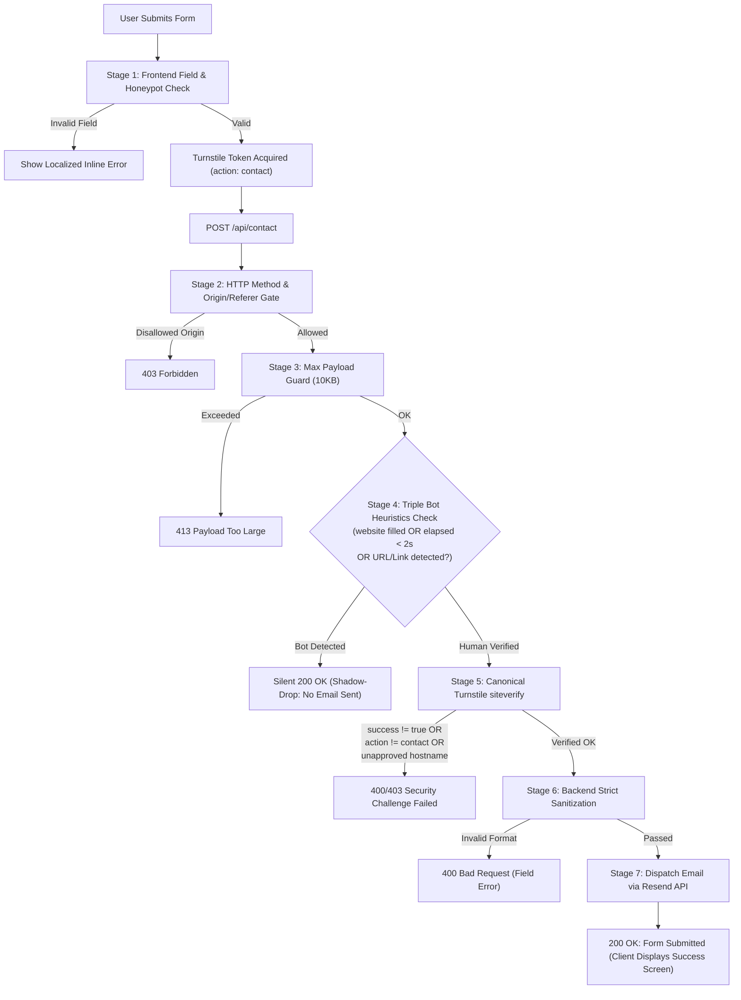

# Form Validation Pipeline & Multi-Tier Anti-Abuse Specifications

## 1. Overview & Policy Objective

This document defines the authoritative, multi-tier **Form Validation Pipeline** for **DOUITSU LLC (DOUITSU合同会社)**.

The contact form serves as the primary corporate gateway for Japanese host enterprises (受入れ機関) and foreign candidates. The pipeline guarantees:
1. **Zero Spam & Bot Elimination**: Combined Cloudflare Turnstile, triple bot heuristics (field honeypot, time heuristic, and URL link injection traps), and origin verification.
2. **Strict Data Integrity**: Rigorous field-level type, length, and format validation matching Japanese B2B standards.
3. **Flawless User Experience**: Instant, trilingual (`ja`, `en`, `my`) inline validation feedback on field blur (`@blur`) and live correction (`@input`).
4. **Canonical Cloudflare Architecture**: Strictly adheres to the Cloudflare Turnstile `spin/prompt.md` canonical siteverify contract (`expectedAction="contact"`, hostname allowlisting, single-use token lifecycle).



---

## 2. Multi-Tier Pipeline Architecture

### Tier 1: Frontend Form Validation (`src/components/Contact.astro`)

| Target Field | Rules & Constraints | Validation Trigger | Inline Error Key (Trilingual) |
|---|---|---|---|
| **Name (`name`)** | • Required<br>• Trimmed whitespace<br>• Min 2 chars, Max 100 chars<br>• Must not contain URLs | `@blur` / `@input` | `siteData.contact.form.nameError` |
| **Email (`email`)** | • Required<br>• RFC 5322 regex compliant<br>• Max 254 chars | `@blur` / `@input` | `siteData.contact.form.emailError` |
| **Phone (`phone`)** | • Required<br>• Japanese & International regex (`^[0-9+\-()\s]{8,20}$`)<br>• Min 8 digits | `@blur` / `@input` | `siteData.contact.form.phoneError` |
| **Message (`message`)** | • Required<br>• Min 10 chars, Max 3,000 chars<br>• Plain text inquiry only (URLs trigger shadow-drop) | `@blur` / `@input` | `siteData.contact.form.messageError` |
| **Field Honeypot (`website`)** | • Must remain empty<br>• Visually hidden off-screen (`tabindex="-1"`, `autocomplete="off"`, `aria-hidden="true"`) | Submission gate | Silently flagged; no user alert |
| **Time Heuristic (`renderedAt`)** | • Timestamp when component mounts (`Date.now()`)<br>• Human submissions take > 2 seconds | Submission gate | Silently flagged; no user alert |
| **Turnstile Widget** | • `data-action="contact"`<br>• `data-theme="light"`<br>• Single-use token | Submission gate | `siteData.contact.form.captchaError` |

---

### Tier 2: Edge Security & Bot Filtering (`functions/api/contact.ts`)

#### 1. Method & Header Verification (CSRF Protection)
- HTTP Method must be `POST`. Any other method returns `405 Method Not Allowed`.
- Content-Type must be `application/json`.
- Origin / Referer validation against the verified domain whitelist:
  - `https://douitsu-co.com`
  - `https://www.douitsu-co.com`
  - `https://demo.douitsu-co.com`
  - *(Development/Preview only: `http://localhost:*`, `http://127.0.0.1:*`)*

#### 2. Payload Guard
- Payload size must not exceed **10 KB** (`10,240 bytes`). Requests exceeding this limit return `413 Payload Too Large` to prevent memory exhaustion, payload inflation, and buffer flooding.

#### 3. Triple Bot Heuristics (Silent Shadow-Drop)
When an automated bot is identified, the backend returns **HTTP 200 OK** (`{ success: true, message: "Message delivered successfully.", id: "shadow-drop-*" }`) without dispatching an email to Resend. The bot believes its spam was successfully submitted and moves on without mutating vectors:

* **Heuristic A (Field Honeypot)**:
  `website` honeypot string is non-empty (`id: "shadow-drop-honeypot"`).
* **Heuristic B (Time-based Heuristic)**:
  Submission elapsed time (`Date.now() - renderedAt`) is less than 2,000 milliseconds (`id: "shadow-drop-speed"`).
* **Heuristic C (URL / Promotional Link Injection)**:
  `name` or `message` contains promotional links, web URLs, or domain extensions (`id: "shadow-drop-url"`).
  Regex Pattern:
  ```regex
  /(https?:\/\/|ftp:\/\/|www\.[a-zA-Z0-9-]+\.[a-zA-Z]{2,}|[a-zA-Z0-9-]+\.(com|org|net|xyz|ru|top|biz|info|cn|cc|me|live|site|online|shop|club|store|vip|pro|icu|work|link|click|app|io|ai)(\/|\b)|\[url=|<a\s+href)/i
  ```

#### 4. Duplicate Submission Guard (30-second window)
- Keyed by `${clientIp}:${email}:${message.slice(0, 50)}`.
- Prevents double-clicking or rapid resubmissions within 30 seconds with `429 Too Many Requests`.

#### 5. Canonical Cloudflare Turnstile siteverify Contract
Following Cloudflare's canonical `spin/prompt.md` standard:
1. Token format check: `typeof token === "string" && token.length > 0 && token.length <= 2048`.
2. POST to `https://challenges.cloudflare.com/turnstile/v0/siteverify` with `10,000ms` AbortSignal timeout.
3. Verification checks:
   - `result.success === true`
   - `result.action === "contact"` (matches `data-action="contact"` on widget)
   - `expectedHostnames.has(result.hostname)` (ensures token was solved for DOUITSU domains)
4. If siteverify fails, return `400 Bad Request` or `403 Forbidden` with diagnostic error codes.

---

### Tier 3: Transactional Dispatch & Delivery (`Resend API`)

- **API Endpoint**: `https://api.resend.com/emails`
- **Headers**:
  - `Authorization: Bearer ${RESEND_API_KEY}`
  - `Content-Type: application/json`
  - `User-Agent: Douitsu-Website/1.2.1`
- **Email Payload**:
  - `from`: `DOUITSU LLC <info@douitsu-co.com>` (or `CONTACT_FROM_EMAIL`)
  - `to`: `[CONTACT_TO_EMAIL]` (`zawlinoo.dev@gmail.com` in staging/testing)
  - `reply_to`: `${name} <${email}>` (allows 1-click email client replies)
  - `subject`: `【お問い合わせ】${name} 様よりWebサイトからのお問い合わせ`
  - `html`: Corporate branded responsive email table with full sender details, timestamp (Asia/Tokyo), and sanitized inquiry copy.
  - `text`: Plain text fallback.

---

## 3. Trilingual Error & Status Code Mapping

All user-visible feedback is localized across **Japanese (`ja`)**, **English (`en`)**, and **Myanmar (`my`)** in `src/data/content.ts`:

| Validation Key | Japanese (`ja`) | English (`en`) | Myanmar (`my`) |
|---|---|---|---|
| `nameError` | お名前を2文字以上で入力してください。 | Please enter a valid name (at least 2 characters). | ကျေးဇူးပြု၍ အမည်ကို အနည်းဆုံး ၂ လုံးနှင့်အထက် မှန်ကန်စွာ ဖြည့်သွင်းပေးပါ။ |
| `emailError` | 有効なメールアドレスを入力してください。 | Please enter a valid email address. | မှန်ကန်သော အီးမေးလ်လိပ်စာ ရိုက်ထည့်ပေးပါ။ |
| `phoneError` | 有効な電話番号を入力してください（8桁以上）。 | Please enter a valid phone number (at least 8 digits). | မှန်ကန်သော ဖုန်းနံပါတ် ရိုက်ထည့်ပေးပါ (အနည်းဆုံး ၈ လုံး)။ |
| `messageError` | お問い合わせ内容を10文字以上で入力してください。 | Please enter your inquiry details (at least 10 characters). | ကျေးဇူးပြု၍ မေးမြန်းလိုသော အကြောင်းအရာကို အနည်းဆုံး စာလုံးရေ ၁၀ လုံးနှင့်အထက် ရေးသားပေးပါ။ |
| `captchaError` | セキュリティ認証（Turnstile）を完了してください。 | Please complete the security check (Turnstile). | ကျေးဇူးပြု၍ လုံခြုံရေးအတည်ပြုချက် (Turnstile) ကို လုပ်ဆောင်ပေးပါ။ |
| `generalError` | 送信に失敗しました。時間をおいてもう一度お試しください。 | Failed to send message. Please try again later. | ပေးပို့မှု မအောင်မြင်ပါ။ ခေတ္တစောင့်ဆိုင်းပြီး နောက်တစ်ကြိမ် ထပ်မံကြိုးစားပေးပါ။ |
| `success` | お問い合わせありがとうございます。送信が完了しました。 | Thank you for contacting us. Your message has been sent successfully. | မေးမြန်းစုံစမ်းမှုအတွက် ကျေးဇူးတင်ရှိပါသည်။ မကြာမီ ပြန်လည်ဆက်သွယ်ပေးပါမည်။ |
| `sending` | 送信中... | Sending... | ပေးပို့နေပါသည်... |

---

## 4. Local Development vs Production Runtime Configuration

| Pipeline Aspect | Local Development (`npm run dev`) | Production (`Cloudflare Pages`) |
|---|---|---|
| **Runtime Engine** | Vite Dev Middleware in `astro.config.mjs` | Cloudflare Pages Function (`functions/api/contact.ts`) |
| **Origin Whitelist** | `localhost:4321`, `127.0.0.1:4321`, `douitsu-co.com`, `demo.douitsu-co.com` | `douitsu-co.com`, `www.douitsu-co.com`, `demo.douitsu-co.com` |
| **Turnstile Secret** | Loaded from local `.env` via `vite.loadEnv` | Cloudflare Pages Dashboard Environment Variables |
| **Resend API Key** | Loaded from local `.env` via `vite.loadEnv` | Cloudflare Pages Dashboard Environment Variables |
| **Honeypot Evaluation** | Active (Shadow-drop 200 OK) | Active (Shadow-drop 200 OK) |

---

## 5. Anti-Abuse Test Scenarios (Verification Commands)

Developers can verify all pipeline defenses locally via `curl`:

```bash
# 1. Field Honeypot Trap (Returns Silent 200 OK shadow-drop)
curl -s -X POST http://localhost:4321/api/contact \
  -H "Content-Type: application/json" \
  -d '{"name":"Bot","email":"bot@spam.com","phone":"09012345678","message":"Hello","website":"http://spam.com"}'
# Response: {"success":true,"message":"Message delivered successfully.","id":"shadow-drop-honeypot"}

# 2. Time Heuristic Trap (< 2s automated script)
curl -s -X POST http://localhost:4321/api/contact \
  -H "Content-Type: application/json" \
  -d '{"name":"Fast Bot","email":"bot@spam.com","phone":"09012345678","message":"Fast submission","renderedAt":9999999999999}'
# Response: {"success":true,"message":"Message delivered successfully.","id":"shadow-drop-speed"}

# 3. URL Spam Injection Trap
curl -s -X POST http://localhost:4321/api/contact \
  -H "Content-Type: application/json" \
  -d '{"name":"Spam","email":"bot@spam.com","phone":"09012345678","message":"Visit https://casino.xyz for deals"}'
# Response: {"success":true,"message":"Message delivered successfully.","id":"shadow-drop-url"}

# 4. Message Under-length (< 10 chars)
curl -s -X POST http://localhost:4321/api/contact \
  -H "Content-Type: application/json" \
  -d '{"name":"User","email":"user@test.com","phone":"09012345678","message":"Short"}'
# Response: {"success":false,"error":"INVALID_MESSAGE","field":"message","message":"Inquiry message must be between 10 and 3,000 characters."}
```

---

## 6. Security & Maintenance Checklist

- [ ] `.env` is never committed to Git (strictly monitored by `.gitignore`).
- [ ] Turnstile secret is only handled server-side in `functions/api/contact.ts` and dev middleware; NEVER exposed to client JS.
- [ ] `turnstile.reset(widgetId)` is invoked on failed submissions and form resets so users can retry with a fresh token.
- [ ] HTML special characters in user inputs are strictly escaped (`escapeHtml`) before email template generation to eliminate HTML injection.
- [ ] Honeypot silent drops are logged for security observability without leaking logic to client callers.
